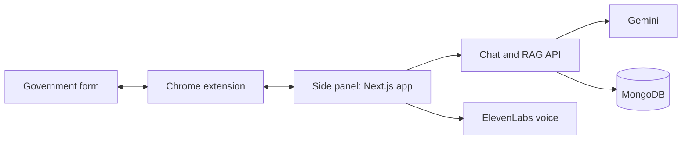

# Gotta Fill 'Em All

A game-style Chrome extension that helps people get through confusing government forms, with an AI companion that reads your documents and guides you field by field.

🏆 **Best Use of DigitalOcean at Hackville**

[](https://www.youtube.com/watch?v=HGkERr3WiFE)

[Watch the demo on YouTube](https://www.youtube.com/watch?v=HGkERr3WiFE)

## Why

Government forms are dense and unforgiving, especially for people with ADHD or dyslexia. We turned a study permit form into an RPG quest, so the work feels manageable instead of overwhelming.

## How it works



- A Chrome side panel runs the Next.js app next to the form you're filling in.
- You chat or speak with the companion, and it answers from your stored documents.
- The extension highlights the matching form fields in gold.
- XP and a companion character make progress feel like a game.

## Tech stack

- **App:** Next.js, React, TypeScript, Tailwind CSS, Framer Motion
- **AI:** Google Gemini, ElevenLabs
- **Data and sign-in:** MongoDB with Mongoose, Clerk
- **Extension:** Chrome Manifest V3 with a side panel
- **Deployment:** Docker on a DigitalOcean Droplet

## Run it locally

You need Node.js, a MongoDB database, and keys for Gemini, Clerk and ElevenLabs.

1. Add these to `.env.local`: `MONGODB_URI`, `GEMINI_API_KEY`, `ELEVENLABS_API_KEY`, `ELEVENLABS_VOICE_ID`, and your Clerk keys.
2. Start the app:

   ```bash
   npm install
   npm run dev
   ```

3. Go to `chrome://extensions`, turn on Developer mode, choose **Load unpacked**, and select the `extension/` folder.
4. Open `http://localhost:3000/demo-form.html` and open the side panel.

Sample documents are in `demo-data/`. For hosting, see the [deployment guide](DEPLOYMENT_GUIDE.md).

## Team

Built by Atinder Harika and Chahatbir Singh at Hackville, January 2026.

## Limitations and what I'd do next

- This is a hackathon prototype, and it isn't hosted right now.
- The side panel loads the app from `localhost:3000`, so it needs a hosted URL to work for other people.
- The RAG step creates and stores embeddings, but retrieval uses MongoDB text search. The next step is real vector search.
- It was built around one demo: a study permit form with sample documents.
- It handles personal documents, so it would need a proper security review before real use.
- This isn't legal or immigration advice.
